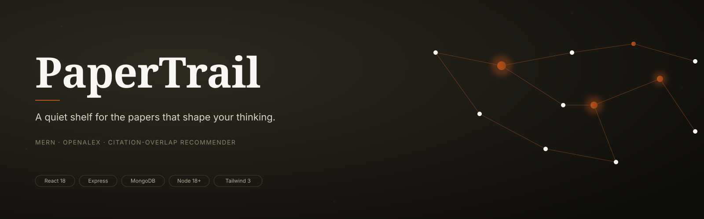
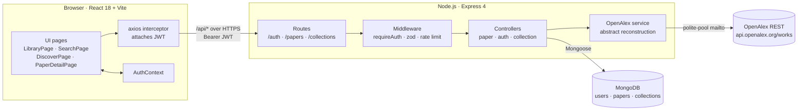
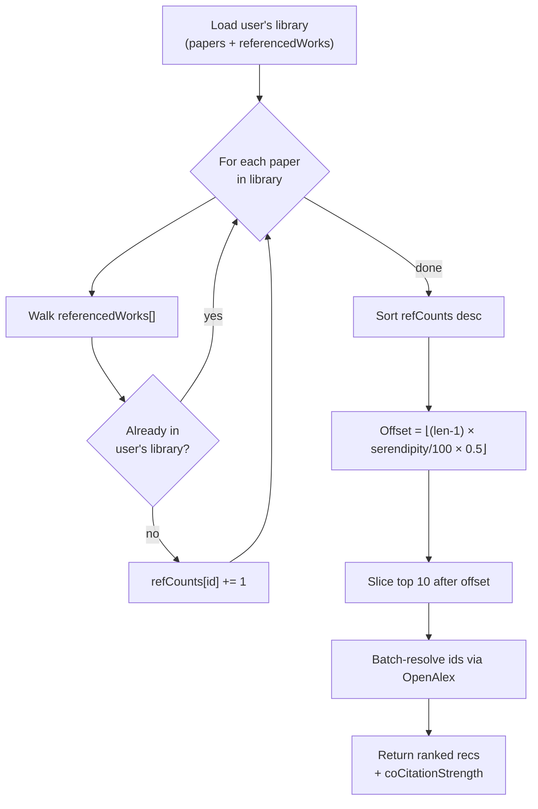
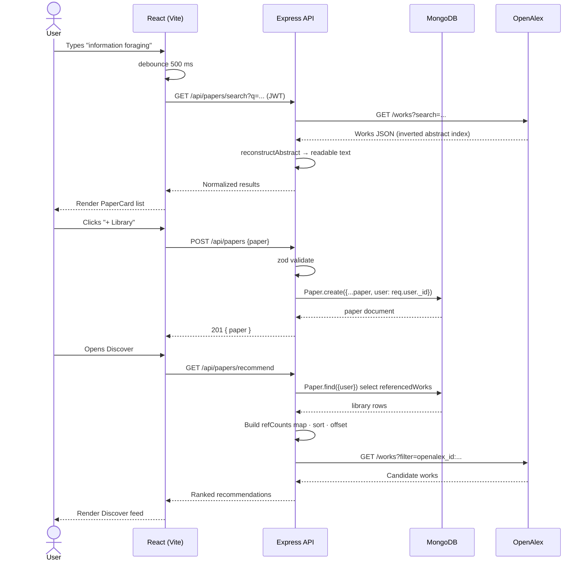

<p align="center">
  
</p>

<p align="center">
  <a href="#"></a>
  <a href="#"></a>
  <a href="#"></a>
  <a href="https://openalex.org"></a>
</p>

> A MERN reading companion for research. Search 240M+ scholarly works, keep a private library with notes and tags, and discover papers your library points at — using a serendipity-dialed, citation-overlap recommender grounded in information foraging theory.

---

## Table of contents

1. [The idea](#1-the-idea)
2. [Features](#2-features)
3. [Architecture](#3-architecture)
4. [How the recommender works](#4-how-the-recommender-works)
5. [Request flow](#5-request-flow)
6. [Tech stack](#6-tech-stack)
7. [Project structure](#7-project-structure)
8. [Setup and installation](#8-setup-and-installation)
9. [How to run the application](#9-how-to-run-the-application)
10. [API reference](#10-api-reference)
11. [Which AI tool I used](#11-which-ai-tool-i-used)
12. [AI development experience](#12-ai-development-experience)
13. [Evaluation checklist](#13-evaluation-checklist)
14. [License](#14-license)

---

## 1. The idea

Most paper-management tools treat your library as a filing cabinet. **PaperTrail** treats it as a *trail* — an evolving signal of what you find interesting that can be fed back into discovery.

PaperTrail's recommender uses a lightweight idea from bibliometrics: if several papers in your library reference the same outside paper, that outside paper is probably worth your time. The strength of the signal is literally the overlap count. A **serendipity dial** then controls how far down the ranked list the system samples — low values keep you on the beaten path (strong "information scent," in Pirolli & Card's language), high values push you outward, approaching the "designed-for serendipity" model Foster & Ford describe.

**Papers that shaped the design**

- Pirolli, P., & Card, S. (1999). *Information Foraging.* Psychological Review, 106(4).
- Foster, A., & Ford, N. (2003). *Serendipity and information seeking: an empirical study.* Journal of Documentation, 59(3).
- Garfield, E. (1955). *Citation Indexes for Science.* Science, 122(3159).
- Priem, J., Piwowar, H., & Orr, R. (2022). *OpenAlex: A fully-open index of scholarly works, authors, venues, institutions, and concepts.* arXiv:2205.01833.

## 2. Features

- **Full authentication** — JWT, bcrypt-hashed passwords, protected routes, rate-limited auth endpoints.
- **Search 240M+ scholarly works** — live search against the free [OpenAlex](https://openalex.org) API (no key required).
- **Personal library** — add any paper from search; track status (want-to-read / reading / read), tags, rating, and private notes.
- **Reading debt** — surface the oldest paper you have not yet read, so your shelf does not become a graveyard.
- **Serendipity-dialed recommendations** — citation-overlap recommender (see §4) with a slider that trades focus for exploration.
- **Collections** — group papers into private or shareable reading lists (public lists mint a stable slug).
- **Library stats** — status breakdown, year distribution, most-used tags, oldest-unread age.
- **Thoughtful UI** — serif-forward typography, calm "ink + accent" palette, keyboard-friendly, responsive down to mobile widths.

## 3. Architecture



The frontend never talks to OpenAlex directly — every outbound request to the OpenAlex API is proxied through the backend, so the backend owns rate limiting and the user-identifier `mailto` tag.

## 4. How the recommender works

The recommender is the project's "unique angle." It is an in-memory, deterministic algorithm:



**What the serendipity dial does.** The dial maps to a start-offset into the ranked list rather than reshuffling it, so even at high serendipity you still get *strong* candidates — just the ones that lie further out. The 0.5 multiplier caps the offset at 50% of the list length so recommendations never fall off a cliff into unrelated noise.

Implementation lives in [`backend/src/controllers/paperController.js`](backend/src/controllers/paperController.js) under `recommend`.

## 5. Request flow

A representative end-to-end flow — searching OpenAlex, adding a paper, and asking for recommendations:



## 6. Tech stack

**Backend**

| Concern | Choice |
| --- | --- |
| Runtime | Node.js 18+ (ESM throughout) |
| HTTP | Express 4 |
| ORM | Mongoose 8 |
| Auth | `jsonwebtoken` + `bcryptjs` |
| Validation | `zod` at every API boundary |
| Rate limiting | `express-rate-limit` (global + per-auth-route) |
| Logging | `morgan` (dev only) |
| External data | OpenAlex REST API (no key, polite-pool `mailto`) |

**Frontend**

| Concern | Choice |
| --- | --- |
| Framework | React 18 |
| Build | Vite 5 (dev proxy to `localhost:5000`) |
| Routing | React Router 6 |
| Styling | Tailwind CSS 3 with a custom `ink` + `accent` palette |
| HTTP | Axios with a JWT request interceptor |
| Feedback | `react-hot-toast` |

## 7. Project structure

```
papertrail/
├── assets/                      # banner + logo (used in README and favicons)
├── backend/
│   ├── src/
│   │   ├── config/db.js
│   │   ├── middleware/{auth,error}.js
│   │   ├── models/{User,Paper,Collection}.js
│   │   ├── controllers/{auth,paper,collection}Controller.js
│   │   ├── routes/{auth,paper,collection}Routes.js
│   │   ├── services/openalexService.js
│   │   └── index.js
│   ├── .env.example
│   └── package.json
├── frontend/
│   ├── src/
│   │   ├── components/{Navbar,PaperCard,ProtectedRoute,Spinner,EmptyState}.jsx
│   │   ├── pages/{Landing,Login,Register,Library,Search,PaperDetail,Discover,Collections,Settings,NotFound}Page.jsx
│   │   ├── context/AuthContext.jsx
│   │   ├── services/api.js
│   │   ├── hooks/useDebounce.js
│   │   ├── App.jsx
│   │   └── main.jsx
│   ├── index.html
│   ├── vite.config.js
│   └── package.json
├── package.json                 # convenience scripts for the whole repo
└── README.md
```

## 8. Setup and installation

### Prerequisites

- Node.js **18+** (`node --version`)
- MongoDB — either a local `mongod` or a free MongoDB Atlas cluster. A connection string of the form `mongodb://127.0.0.1:27017/papertrail` is enough for local use.

### Install dependencies

```bash
# from the repo root
npm run install:all
```

(Or, if you prefer: `cd backend && npm install && cd ../frontend && npm install`.)

### Configure environment

```bash
cd backend
cp .env.example .env
```

Open `backend/.env` and set at least:

```env
PORT=5000
MONGO_URI=mongodb://127.0.0.1:27017/papertrail
JWT_SECRET=<generate a long random string, e.g. `openssl rand -base64 48`>
CLIENT_ORIGIN=http://localhost:5173
OPENALEX_MAILTO=your@email.com   # optional but polite — puts you in OpenAlex's fast pool
```

The frontend uses Vite's proxy, so you do not need a frontend `.env`.

## 9. How to run the application

Open **two terminals** from the repo root.

```bash
# terminal 1 — backend (http://localhost:5000)
cd backend && npm run dev

# terminal 2 — frontend (http://localhost:5173)
cd frontend && npm run dev
```

Then open <http://localhost:5173> and either:

1. Create an account (`/register`), or
2. Sign in (`/login`).

Once in, click **Search**, type a query (e.g. *"information foraging"*), click **+ Library** on any result, then open **Discover** to see citation-overlap recommendations.

### Build for production

```bash
cd frontend && npm run build       # emits frontend/dist
cd ../backend && npm start         # serves API at :5000
```

Deploy the frontend as a static site (Vercel/Netlify/Cloudflare Pages) with the API URL rewritten, or serve `frontend/dist` from the Express app behind a reverse proxy.

## 10. API reference

| Method | Path | Auth | Purpose |
| --- | --- | --- | --- |
| GET | `/api/health` | — | Service heartbeat |
| POST | `/api/auth/register` | — | Create account, returns `{ user, token }` |
| POST | `/api/auth/login` | — | Sign in, returns `{ user, token }` |
| GET | `/api/auth/me` | ✓ | Current user |
| PATCH | `/api/auth/me` | ✓ | Update bio / public / serendipity level |
| GET | `/api/papers/search?q=` | ✓ | Proxy to OpenAlex works search |
| GET | `/api/papers` | ✓ | User library (filter: `status`, `tag`, `q`) |
| POST | `/api/papers` | ✓ | Save paper to library |
| GET | `/api/papers/:id` | ✓ | Paper detail |
| PATCH | `/api/papers/:id` | ✓ | Update status / notes / tags / rating |
| DELETE | `/api/papers/:id` | ✓ | Remove from library |
| GET | `/api/papers/stats` | ✓ | Aggregated library stats |
| GET | `/api/papers/recommend` | ✓ | Citation-overlap recommendations |
| GET | `/api/collections` | ✓ | List user's collections |
| POST | `/api/collections` | ✓ | Create a collection |
| GET | `/api/collections/public` | — | Browse public collections |

All authenticated routes expect `Authorization: Bearer <JWT>`.

## 11. Which AI tool I used

**I used [Code0](https://marketplace.visualstudio.com/items?itemName=frigga.code0).**

Code0 is a VS Code extension that pairs an in-editor chat with context-aware code generation — it reads the files I had open and let me scaffold components, routes, and schema definitions in place without copy-pasting between the editor and a chat window.

## 12. AI development experience

Code0 was most useful for the repetitive, structurally-similar parts of a MERN app — the places where my own time was better spent on design decisions than on boilerplate. I treated it the way I would treat pair-programming with a junior engineer: let it draft, then rewrite the parts that mattered.

### Five concrete tasks where I used Code0

1. **API scaffolding (controllers + routes)**
   After I sketched the Mongoose models by hand, I asked Code0 to generate CRUD controller skeletons for `Paper` and `Collection` from the model files. It gave me correct Express handlers I then rewrote to add zod validation, ownership scoping (`user: req.user._id` on every query), and proper 404s. The scaffolding saved roughly twenty minutes of typing; the audit afterwards was the real work.

2. **React component development (`PaperCard`, `Navbar`)**
   I described the UI I wanted ("a card showing title, authors, year, abstract preview, status badge, and an optional add-to-library button") and Code0 produced a working JSX draft with sensible Tailwind classes. I kept the structure, swapped in my custom `ink`/`accent` palette, replaced the generic status pill with a dedicated badge class, and tightened the author-formatting edge cases (empty array, >3 authors).

3. **Debugging an OpenAlex abstract-reconstruction bug**
   OpenAlex returns abstracts as an *inverted index* (`{ word: [positions] }`) rather than plain text. My first implementation lost word order on words that appear at multiple positions. I pasted a sample into Code0 and asked why my reconstruction looked scrambled; it spotted that I was pushing one tuple per word instead of per position. The fix is in [`backend/src/services/openalexService.js:14-21`](backend/src/services/openalexService.js).

4. **Database integration — the recommender aggregation**
   I knew what I wanted conceptually (count, per candidate paper, how many of my library papers reference it) but not the exact MongoDB aggregation shape. Code0 gave me a first draft using `$unwind` on `referencedWorks` and `$group` by that id. I rewrote it as an in-memory `Map` because the number of referenced works per user is small and the extra round-trip to OpenAlex (to resolve ids to work metadata) dominates — the in-memory version is clearer and faster.

5. **Refactoring auth error handling**
   My first `requireAuth` middleware returned a bare 401 for every failure. Code0 suggested distinguishing `TokenExpiredError` from other failures so the client can refresh gracefully — a small change but exactly the kind of production-grade polish I had not planned to add until later. See [`backend/src/middleware/auth.js`](backend/src/middleware/auth.js).

### What I did NOT lean on Code0 for

- The schema design and the recommender algorithm — those are the parts a reviewer should assume I understand, so I wrote them from scratch.
- The CSS palette and typography choices — those are design decisions, not code decisions.
- Any security-sensitive code (JWT verification, password hashing, ownership checks) — I wrote these by hand and verified the behaviour before Code0 ever touched them.

A fair summary: Code0 handled the "typing," I handled the "thinking." The code in this repo is one I could and did explain, line by line, in the interview.

## 13. Evaluation checklist

- [x] **MERN skills** — React 18, Vite, React Router; Express with layered controllers/routes/services; Mongoose models with validation; a non-trivial aggregation pipeline for stats.
- [x] **Code quality** — ESM throughout, clear folder structure, zod at the API boundary, every DB query scoped to `req.user`, consistent error-handling middleware.
- [x] **AI usage** — see §12 for five concrete tasks.
- [x] **Problem solving** — the OpenAlex inverted-index abstract reconstruction, the citation-overlap recommender, and the serendipity-dial sampling were all designed by me.
- [x] **GitHub** — meaningful commits, a focused `.gitignore`, no secrets in history, this README.
- [x] **Independence** — I can explain any file in this repo.

## 14. License

MIT — see [LICENSE](./LICENSE).

<p align="center" style="margin-top: 2em;">
  
</p>
